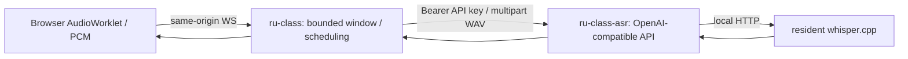

# Current v0.1 interface revision · 2026-10-16

This document supersedes the earlier outbound Worker topology and full-width bottom toolbar. The user's correction explicitly authorizes the following v0.1 boundary; no later-version model integrations are added.

| Owner | Module / responsibility |
| --- | --- |
| ru-class | apps/web: course input, capture, right-half bottom toolbar, API settings and live RU; later-version placeholders only |
| ru-class | gateway.ts: same-origin browser sessions, local bootstrap, in-memory API settings; no API key is returned to browser |
| ru-class | audio-window.ts / session.ts: 8 s bounded window, 1 s step, 2 s first inference, coalescing, stop/flush/cancel |
| ru-class | inference.ts: OpenAI-compatible `/models` validation and `/audio/transcriptions` with model, language=ru, response_format=json and Bearer key |
| ru-class-asr | api.ts: standalone authenticated `/v1/models` and `/v1/audio/transcriptions`, WAV validation, one active inference, cancellation |
| ru-class-asr | inference.ts: internal whisper.cpp `/inference` adapter; index.ts probes resident engine before serving API |

ASR has no runtime dependency on the main application and does not register with it. Previous worker.ts and legacy WS tests remain as migration regression utilities; neither current entry point starts them. Browser protocol stays 0.1; its historical worker-shaped field names are internal status fields, not a second credential the operator must enter.

## Configuration and credentials

ASR local `.env`: ASR_API_KEY (random, at least 24 characters), ASR_PORT=8090, WHISPER_URL pointing to local whisper.cpp, WHISPER_MODEL=small. Main local `.env`: ASR_BASE_URL=http://127.0.0.1:8090/v1, matching ASR_API_KEY, ASR_MODEL=small. The main app calls the API on the server; keys are not embedded in assets or returned by configuration responses.

The local Settings dialog can save and test API address/model/key for the current server process. A blank key retains the configured key at the same address; changing address requires a new key. It is not written to browser storage or source files. Persist restarts with the ignored server `.env`. Keep env files mode 0600. ASR credentials are independent from future multimodal and language model credentials, which remain unimplemented.

The old gateway access token was browser-to-main authentication, not a model API key. Current local startup generates this internal credential automatically; the local bootstrap endpoint delivers it only with loopback peer + literal localhost/127.0.0.1 Host validation. Configuration POST additionally requires same-origin Origin and internal Bearer credential. The default startup binds only to loopback and rejects public-origin/public-listener settings: remote site authentication and deployment need a separately reviewed setup. This does not expose an unauthenticated public configuration endpoint. Remote ASR URLs require HTTPS; redirects are rejected to avoid forwarding credentials.

## API subset

OpenAI-compatible request/response shape, not the full OpenAI API. Auth: Authorization: Bearer <ASR_API_KEY>. GET /v1/models returns data[{id,object,owned_by}]. POST /v1/audio/transcriptions accepts multipart file and model; optional language defaults ru and response_format defaults json. v0.1 only accepts 16 kHz mono PCM16 WAV, 0–30 s (nonempty), up to 2 MiB total request; model must match advertised model. json returns {text}; text returns plain text. Other language/format/model or invalid WAV receives 400, invalid key 401, busy inference 429, engine failure 502. No streaming/SSE, MP3 decoder, timestamps or permanent audio storage is claimed. Streaming captions come from repeated overlapping requests scheduled by ru-class. Multiple projects may call this API; one inference is admitted at a time.

## UI and verification

Bottom toolbar belongs inside the right half, in order: start/stop, duration, metrics, Settings at far right. Desktop 1366×900 measured left/right widths 683 each; toolbar x=684, width=682, bottom=900. 390×844 and 900×400 had no document overflow and toolbar bottoms at 844/400. Actual Settings save/test succeeded without returning or displaying the saved key. No browser warning/error observed.

Automated evidence: main 13/13 (with adjacent ASR repository), ASR 7/7, both typechecks/builds passed. New tests use explicit SIMULATED_API_TRANSCRIPT fixtures for auth, Host/Origin/config access, blank-key retention, active-session settings lock, actual multipart API chain, early captions/tail flush, WAV/model rejection, busy and cancellation. A legacy 2.2 s replay fixture was increased to 3.2 s to allow the first 2 s inference threshold to return under concurrent test load; this is still explicitly simulated.

Actual M1 smoke through the new independent API: existing synthetic Russian WAV, 8 s paced audio, 40 frames, 6 results, captions before stop and successful stop completion. Mean HTTP request time 1190.0 ms, p95 1610.5 ms; replay audio-end-to-result mean 1304.2 ms, p95 1620.3 ms. These six samples include new API overhead and current machine load and are not a benchmark comparison. They exclude microphone/input buffering and browser render. Backend remains a label until checked against engine logs; the same resident engine has earlier independent M1 Metal evidence. No M4 or five-minute natural Russian acceptance claim. Metrics contain no transcript, host, filename or secret.

M4 formal acceptance remains deferred. Source and clean UI screenshots are committed locally; no push or production deployment is performed.
