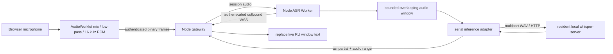

# v0.1 architecture and module ownership

| Repository / module | Responsibility |
| --- | --- |
| ru-class / `apps/web/audio.js` | Portable streaming resampler and binary PCM encoder; original-to-16 kHz sample mapping |
| ru-class / `capture-worklet.js` | Mix channels, retain filter context, send 200 ms frames, flush tail |
| ru-class / `app.js` | User permission, session lifecycle, bounded socket backlog, capture errors, replacement subtitles and local-clock latency estimate |
| ru-class / `index.html`, `style.css` | 1:1 fullscreen viewport layout, narrow-screen layout, truthful later-version placeholders |
| ru-class / `apps/server/src/gateway.ts` | Same-origin HTTP assets, independent token authentication, one-session ownership, metadata validation, WS routing and liveness |
| both / `protocol.ts` | Version 0.1 types, binary encoding/validation, strict sequence and sample continuity |
| ru-class-asr / `audio-window.ts` | At most one bounded PCM ring-equivalent buffer, audio sample ranges, PCM WAV header |
| ru-class-asr / `session.ts` | Single running inference, coalesced latest window, stop flush, cancellation and stale result suppression |
| ru-class-asr / `inference.ts` | Platform-independent adapter contract and whisper.cpp multipart HTTP implementation |
| ru-class-asr / `worker.ts`, `index.ts` | External service probe, outbound authentication, ready/model/OS/unverified-backend reporting, session routing |
| ru-class-asr / `scripts/replay.ts` | Real-time paced WAV acceptance driver and local privacy-reduced metrics report |

Audio/time ownership: the browser generates a course sample sequence; neither gateway nor inference completion creates audio timestamps. The gateway and Worker independently check continuity. The Worker maps each result to its snapshot's `[start,end)` samples. There is no committed text layer in v0.1.

Data lifetime: browser frame buffers, gateway transient messages and an at-most-8-second default Worker audio buffer are memory-only. Pending inference is coalesced rather than queued indefinitely. The user must separately preserve important recordings. The preview and tests do not implement course archives or long-term transcript storage. Raw recognized text is not logged by default.

Deployment boundary: gateway is lightweight and independently deployed on a VPS; external whisper-server is local to the ASR host and holds the model resident. Platform-specific build/acceleration is outside the portable Worker. Only loopback development may use cleartext; public gateways use HTTPS/WSS and exact PUBLIC_ORIGIN. Browser and Worker secrets are distinct and supplied locally. No OpenAI or DeepSeek API credentials are required in v0.1.

Validation boundary: mock HTTP/adapter tests prove scheduling and protocol behavior. They cannot prove Russian accuracy, GPU selection, real microphone continuity or hardware latency. The acceptance report records these independently.
